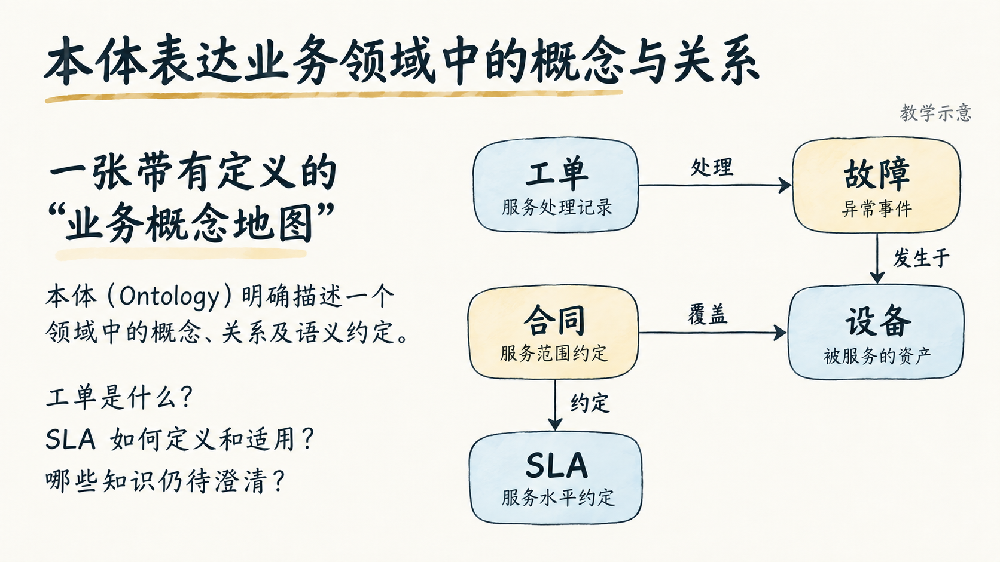

# 本体论与 Agent：简约手绘 PPT 样张

选取 2026-10-12 草稿的**第 5 页：本体表达业务领域中的概念与关系**，先制作一页确认视觉效果。原稿共 22 页，本目录仅含 1 页样张。

## 风格描述

**简约手绘业务概念图**：暖白纸底、深灰墨线，以少量灰蓝和赭黄点色。线条略带自然手绘感，中文字形清晰规整。用宽松留白和少量关系节点讲清概念，适合业务、产品与技术混合受众。

参考 baoyu 的 `sketch-notes`，收敛为更克制的商务教学风格。关系图明确标注“教学示意”，不代表真实运行模型或验收结论。

## 查看样张

- [查看 PNG](05-slide-business-concept-map.png)
- [下载单页 PPTX](ontology-agent-preview.pptx)
- [下载单页 PDF](ontology-agent-preview.pdf)

PPTX 为 16:9 的整页图片式幻灯片，文字与节点不是独立可编辑对象；演讲者备注保留原稿的概念解释、教学边界和来源。

## 原稿与复现记录

- [完整文字草稿](source-ontology-agent-draft.md)：原稿相对链接已转换为原项目 GitHub 地址。
- [内容分析与范围](analysis.md)
- [样张大纲与完整风格定义](outline.md)
- [最终图片生成提示词](prompts/05-slide-business-concept-map.md)

制作使用 `baoyu-slide-deck` v1.117.4 与 Codex 内置 imagegen。PPTX、PDF 使用 baoyu 配套脚本封装，随后将 PPTX 演讲者备注整理为原稿讲解内容。此次仅提供一页预览，后续页面待视觉效果确认后制作。
