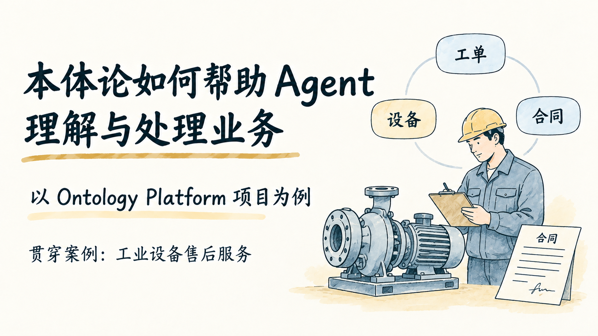
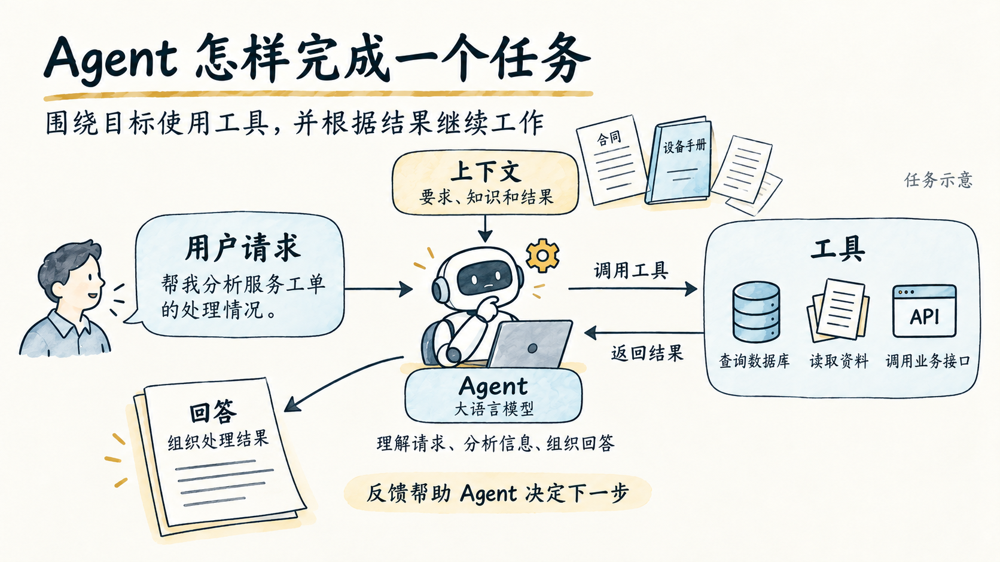
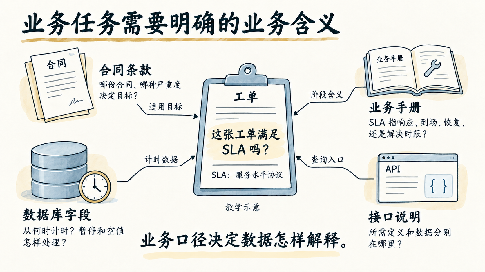
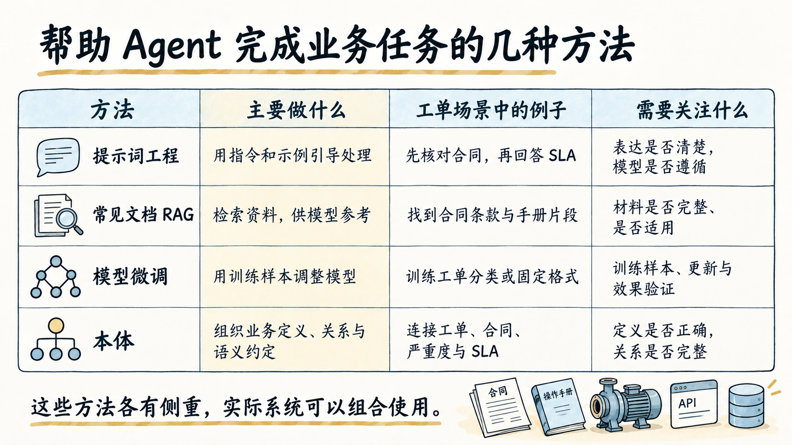

# 本体论与 Agent：第一部分

根据 2026-10-12 文字草稿制作，包含封面和“Agent 与已有方法”，对应**第 1—4 页，共 4 页**，预计讲解约 6 分钟。

## 下载与查看

- [下载 4 页 PPTX](ontology-agent-part1.pptx)
- [查看 4 页 PDF](ontology-agent-part1.pdf)

PPTX 为 16:9 的整页图片式幻灯片，中文字与插图不是独立可编辑对象。每页演讲者备注保留原稿说明与来源。

## 本次风格调整

延续暖白纸底、深灰墨线、灰蓝与赭黄的简约手绘风格，稍微增加与内容相关的视觉元素：设备与服务人员、工具与资料图标、反馈回路、时钟与接口示意。不同页面使用不同版式，中文和信息层级保持清晰。

### 1. 本体论如何帮助 Agent 理解与处理业务

### 2. Agent 怎样完成一个任务

### 3. 业务任务需要明确的业务含义

### 4. 帮助 Agent 完成业务任务的几种方法

## 内容与复现记录

- [完整文字草稿](source-ontology-agent-draft.md)
- [制作范围与内容分析](analysis.md)
- [逐页大纲与风格定义](outline.md)
- [讲解备注](speaker-notes.json)
- [图片生成提示词](prompts/)
- [样张风格参考](refs/01-style-reference.png)

使用 `baoyu-slide-deck` v1.117.4 与 Codex 内置 imagegen。PPTX、PDF 使用 baoyu 配套脚本封装；PPTX 中的生成提示替换为原稿的讲解备注。案例和任务图保留示意标记，方法比较不做优劣排名，不虚构实际运行或验收结果。
